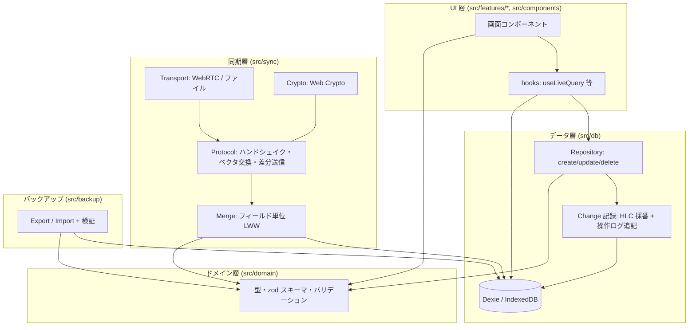

# 03. システム構成

## 全体像

サーバーは存在しません。静的ファイル（HTML/JS/CSS）の配信元だけがあり、そこには**ユーザーデータは一切送られません**。ストア版では配信元すら不要（アプリに同梱）です。

```mermaid
flowchart LR
  subgraph Host["静的ホスティング (PWA 版のみ / 初回と更新時だけ)"]
    S[HTML / JS / CSS / アイコン]
  end

  subgraph A["端末 A (例: Android)"]
    direction TB
    UIA[UI: React] --> RA[Repository 層]
    RA --> DBA[(IndexedDB<br/>Dexie)]
    RA --> OLA[操作ログ + HLC]
    SYA[Sync Engine] --> OLA
    SWA[Service Worker<br/>オフラインキャッシュ]
  end

  subgraph B["端末 B (例: iPhone)"]
    direction TB
    UIB[UI: React] --> RB[Repository 層]
    RB --> DBB[(IndexedDB<br/>Dexie)]
    RB --> OLB[操作ログ + HLC]
    SYB[Sync Engine] --> OLB
    SWB[Service Worker]
  end

  S -. "アプリ本体のみ (データなし)" .-> SWA
  S -. .-> SWB
  A <== "① QR コードで接続情報を交換 (カメラ)" ==> B
  SYA <== "② WebRTC DataChannel (同一 Wi-Fi, DTLS + アプリ層 AES-GCM)" ==> SYB
  SYA <-. "③ 代替: 暗号化同期ファイル (共有シート経由)" .-> SYB
```

## レイヤー構成



**原則**

- UI は Repository 経由でしか書き込まない → すべての変更が必ず操作ログに残り、同期漏れが起きない。
- 外部から入ってくるデータ（同期・バックアップ）は必ず zod スキーマを通す → 不正データが DB に入らない。
- Transport は差し替え可能（WebRTC / 暗号化ファイル / 将来のネイティブ TCP）。Protocol と Merge は共通。

## ディレクトリ構成（Phase 2 で作成）

```
family-hub/
├─ docs/                    設計ドキュメント
├─ public/                  アイコン・manifest 用画像
├─ src/
│  ├─ app/                  ルーティング・レイアウト・テーマ・プロバイダ
│  ├─ components/           共通 UI 部品 (Button, Sheet, ListItem, EmptyState ...)
│  ├─ features/
│  │  ├─ home/
│  │  ├─ shopping/
│  │  ├─ memos/
│  │  ├─ calendar/
│  │  ├─ tasks/
│  │  ├─ members/
│  │  └─ settings/          バックアップ・同期・表示設定
│  ├─ domain/               エンティティ型・zod スキーマ・共通ロジック
│  ├─ db/                   Dexie スキーマ・マイグレーション・Repository・HLC
│  ├─ sync/                 transport / protocol / merge / pairing / crypto
│  ├─ backup/               export / import / validate
│  ├─ i18n/                 文言辞書 (ja を先行)
│  ├─ styles/               デザイントークン・グローバル CSS
│  └─ sw.ts                 Service Worker
├─ tests/
│  ├─ unit/
│  └─ e2e/
└─ spikes/                  技術検証コード (本番には含めない)
```

## PWA / オフライン設計

- **プリキャッシュ**: ビルド成果物すべて（JS/CSS/アイコン/フォント不使用）を Service Worker が初回インストール時にキャッシュ。以降はネットワークなしで起動。
- **更新**: 新バージョン検出時に「更新があります」バナーを表示し、ユーザー操作で適用（編集中データの喪失を防ぐため自動リロードしない）。
- **ネットワークへのリクエスト**: アプリ本体の更新確認以外は発生させない。CSP の `connect-src 'self'` で強制する（WebRTC は CSP の対象外であり、STUN/TURN を設定しないことで外部通信を防ぐ）。
- **ストレージ永続化**: 初回起動時に `navigator.storage.persist()` を要求。iOS ではホーム画面に追加された PWA は Safari の 7 日間ストレージ削除ポリシーの対象外だが、ブラウザタブでの利用時は対象となるため、ホーム画面への追加を案内する。
- **manifest**: `display: standalone`, `orientation: portrait`, テーマ色はライト/ダーク両対応、マスカブルアイコン。

## ネイティブ化（将来）の差分

| 項目 | PWA | Capacitor ネイティブ |
|---|---|---|
| UI / DB / 同期プロトコル | 共通 | 共通 |
| ストレージ | IndexedDB | IndexedDB（WebView）→ 必要なら SQLite プラグインへ Repository 層で差し替え |
| 端末発見 | QR 交換が毎回必要 | Bonjour/NSD で同一 Wi-Fi の家族端末を自動発見（初回ペアリングのみ QR） |
| 通信 | WebRTC | WebRTC または ネイティブ TCP + Noise/TLS |
| 配布・課金 | Web | ストアの有料アプリ（買い切り）|
