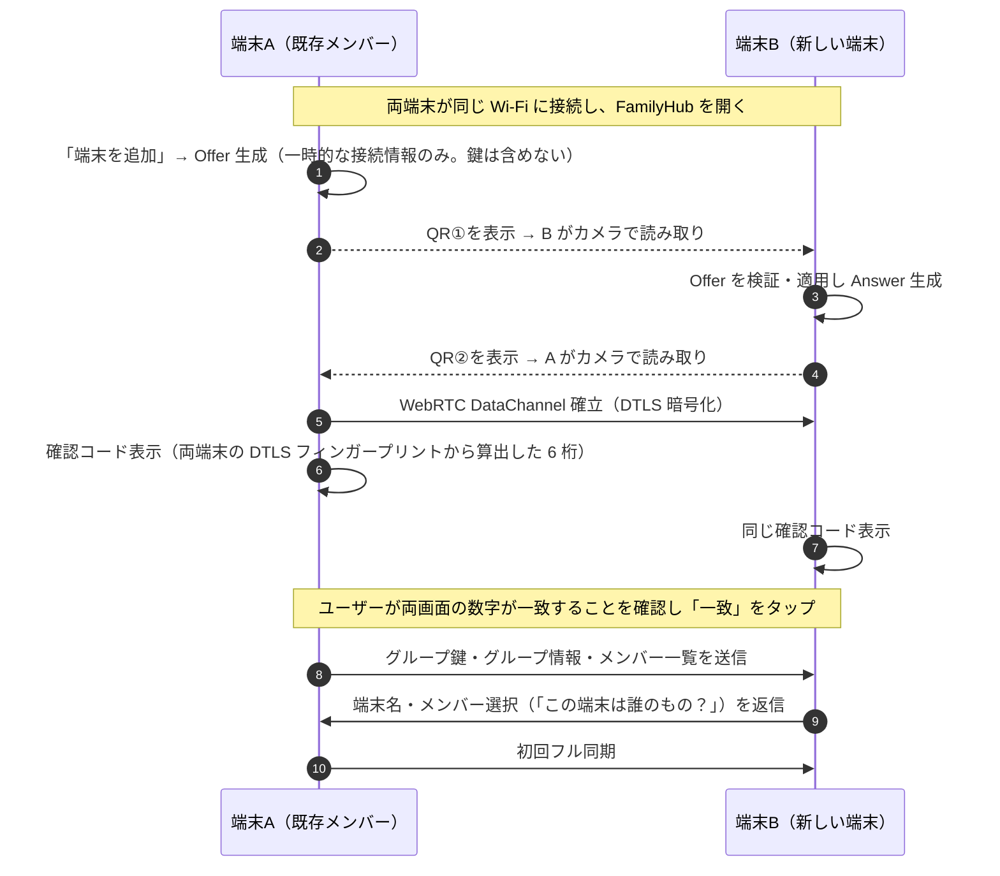

# 06. オフライン・端末間同期方式（技術検証）

> この文書は「サーバーを使わずに、異なるスマートフォン間で、どう通信するか」の検証結果と採用方式です。
> **実装状況 (2026-11-08)**: §4 の方式はすべて実装済み (`src/sync/`)。自動テストの範囲と未検証事項は [testing.md](./testing.md) を参照。
> **実機で未検証の事項は「未検証」と明記しています。**

## 1. 前提となるブラウザの制約

| 制約 | 内容 | 影響 |
|---|---|---|
| ブラウザは生のソケットを開けない | TCP/UDP の待ち受け、LAN 内の端末探索（mDNS/Bonjour）は Web からは不可能 | 「同じ Wi-Fi にいる家族の端末を自動で見つける」ことは PWA では**できない** |
| 端末間直接通信の手段は WebRTC のみ | WebRTC は接続前に「接続情報（SDP）」を互いに交換する必要がある（シグナリング） | 通常はシグナリングサーバーを使うが、本アプリでは**QR コードで交換**する |
| 接続情報は接続ごとに変わる | ICE 資格情報・ポート・mDNS 名は接続毎に再生成される | 同期のたびに QR 交換が必要（再利用不可） |
| ローカル IP の秘匿（mDNS 難読化） | Chrome / Safari は host 候補を `<UUID>.local` として公開し、相手側ブラウザがマルチキャスト DNS で解決する | ルーターがマルチキャストを遮断していると解決できず接続失敗の可能性。※カメラ等の権限が許可されたページでは生 IP が公開される実装がある（要実機検証） |
| バックグラウンド動作不可 | PWA は画面を閉じると通信できない。iOS は特に厳しい | 同期は両端末でアプリを開いている間だけ |
| NAT 越え | サーバー（STUN/TURN）なしでは異なるネットワーク間の接続は原則不可 | 遠隔地の家族とのリアルタイム同期は**できない**（→ 暗号化ファイルで代替） |

## 2. 検討した方式

| 方式 | 外部サーバー | iOS | Android | 評価 |
|---|---|---|---|---|
| **A. WebRTC + QR 手動シグナリング（同一 Wi-Fi）** | 不要 | ○（Safari は DataChannel 対応） | ○ | **採用（主方式）**。Spike で接続成功を確認 |
| B. WebRTC + シグナリングサーバー | 必要 | ○ | ○ | プライバシー方針に反するため不採用（将来の任意オプションとしても慎重に検討） |
| C. Web Bluetooth | 不要 | ×（Safari 非対応） | △（GATT クライアントのみ、端末同士の直接通信は不可） | 不採用 |
| D. Web NFC | 不要 | × | △（Chrome Android のみ） | 不採用 |
| E. ローカル HTTP サーバー | 不要 | × | × | ブラウザでは不可能。ネイティブ化後の選択肢 |
| **F. 暗号化同期ファイル（共有シート）** | 不要* | ○ | ○ | **採用（代替手段）**。AirDrop / Quick Share / メッセージアプリ等で送る。*経路は OS/ユーザー任せだが中身は E2E 暗号化 |
| G. アニメーション QR（複数フレームでデータ転送） | 不要 | ○ | ○ | 将来検討。完全オフライン・異 OS 間でも動くが低速（数 KB/秒） |
| H. ネイティブ（Capacitor）Bonjour/NSD + TCP | 不要 | ○（ローカルネットワーク権限） | ○ | **ストア版で導入予定**。初回ペアリング以降は QR 不要の自動同期が可能 |

## 3. 技術検証の結果（Spike）

コード: [`spikes/webrtc-qr/`](../spikes/webrtc-qr/)（`npm test` で再現可能）

**確認できたこと（2026-11-08, Chromium 1243, 2 プロセス, 同一 Linux マシン）**

- ✅ STUN/TURN/シグナリングサーバーなし（`iceServers: []`）で 2 つの独立したブラウザ間に DataChannel 接続が確立し、双方向通信できた。mDNS 難読化あり/なしの両方で成功。
- ✅ SDP 約 560〜590 バイト → 圧縮コード 100〜196 文字（Offer は招待情報約 60 バイト込み）。**QR バージョン 9 以下（誤り訂正 M）に収まる**。
- ✅ QR 画像生成 → デコードの往復でデータが一致（qrcode + jsQR）。
- ✅ 接続情報の DTLS フィンガープリントを 1 bit 改ざんすると、ICE は通っても **DTLS で接続が拒否される**ことを確認 → QR が正しく読めていれば中間者攻撃は成立しない。
- ✅ 不正な QR 文字列（不正文字・途中切れ・SDP インジェクション）を拒否。

**確認できていないこと（Phase 3〜4 の実機検証項目）**

| ID | 検証項目 | リスク | 失敗時の対処 |
|---|---|---|---|
| V-1 | Android Chrome ⇔ iPhone Safari（ホーム画面 PWA）間の接続 | 中 | ブラウザ固有の SDP 差異をコーデックで吸収。最終的に不可なら F 方式 |
| V-2 | 家庭用 Wi-Fi ルーターでの mDNS 候補解決 | **高** | カメラ使用中（QR 読み取り中）に候補を収集し生 IP を得られるか検証。不可なら F 方式に誘導 |
| V-3 | AP 分離・ゲスト Wi-Fi 環境での挙動 | 確実に失敗 | 失敗を検知して「ファイルで同期」に誘導（タイムアウト 15 秒） |
| V-4 | iOS standalone PWA でのカメラ QR 読み取り速度 | 中 | jsQR → zxing-wasm へ切替、QR を大きく表示 |
| V-5 | iOS で画面ロック/アプリ切替時の切断・再開 | 中 | 冪等な差分同期で再開、UI で「画面を開いたままにしてください」 |
| V-6 | 1 万件規模の初回同期の所要時間 | 低 | チャンク分割・進捗表示 |

> **実機検証を行うまで、「Android と iPhone 間で同期できる」とは表記しません。**
> README・ストア説明にも検証済みの組み合わせだけを記載します。

## 4. 採用方式の詳細

### 4.1 用語

- **家族グループ**: 共有データの単位。`groupId` と 32 byte の **グループ鍵** を持つ。
- **ペアリング**: 新しい端末を家族グループに参加させる（初回のみ）。
- **同期**: 既にグループに参加している端末同士で差分を交換する（随時）。

### 4.2 ペアリング手順（初回のみ）

- QR には**長期的な秘密を載せない**。QR を撮影・盗み見されても、その後の DTLS 接続に割り込めない（フィンガープリントが一致しないと接続できないことを Spike で確認済み）。
- 確認コード（SAS）は、QR の取り違え（別の家族の QR を読んだ等）を人間が検出するため。
- 同時に全メンバーへ周知する仕組みはないため、新端末の情報は以降の通常同期で他の家族端末にも伝わる。

### 4.3 通常同期の手順

1. どちらかの端末で「同期」→ QR① 表示、相手が読み取り → 相手が QR② 表示、こちらが読み取り（**約 10〜20 秒を想定・要実機計測**）
2. DataChannel 確立後、アプリ層で**相互認証**: 双方が乱数 nonce を交換し、`HMAC(グループ鍵から HKDF で導出した認証鍵, nonceA ‖ nonceB ‖ 両フィンガープリント ‖ 役割)` を送り合う。不一致なら即切断（グループ外の端末とは同期しない）。
3. プロトコルバージョン・バージョンベクタを交換。
4. 互いに相手が持っていない操作ログだけを送信（16 KB 以下のチャンクに分割。各チャンクはグループ鍵由来の鍵で AES-GCM 暗号化、通し番号を AAD に含めて再送・順序入れ替えを検知）。
5. 受信側はチャンクを zod 検証 → マージ（[04-data-model §6](./04-data-model.md)）→ ベクタ更新 → ACK。
6. 双方完了で「同期済み」。3 台以上の家族は、A⇔B、B⇔C と同期すれば A の変更も C に伝わる（操作ログは中継される）。

**QR 操作を減らす工夫（PWA の範囲内）**
- 同期画面は「QR 表示」と「カメラ」を 1 画面に同居させ、読み取ったら自動で次の QR を出す。
- 家族が複数台いる場合、1 台の「ハブ役」（例: リビングのタブレット）と順に同期する運用を案内。

### 4.4 失敗時の再試行と復旧

| 失敗 | 検知 | 復旧 |
|---|---|---|
| 接続できない（V-2, V-3） | 15 秒以内に DataChannel が開かない | 「もう一度試す」/「ファイルで同期」を提示。原因の可能性（ゲスト Wi-Fi 等）を平易に表示 |
| 途中切断 | `close` / ACK タイムアウト | 受信済みチャンクは適用済み（冪等）。再接続後、ベクタ交換から再開するので重複・欠落なし |
| 認証失敗 | HMAC 不一致 | 切断し「別の家族グループの端末です」と表示 |
| 不正データ | zod 検証失敗・復号失敗 | そのチャンクを破棄して切断。ログに個人情報を含めないエラー種別のみ記録 |
| バージョン非互換 | protocolVersion | 古い側に「アプリを更新してください」 |

各 `peers` レコードに最後の結果を保存し、同期履歴画面で確認できるようにします。

### 4.5 代替手段: 暗号化同期ファイル

Wi-Fi で接続できない場合・遠隔地の家族向け。

1. 送信側: 「ファイルで同期」→ 相手の最終既知ベクタ以降の操作ログ（不明なら全件）を `.fhsync` ファイルに書き出し。中身は **グループ鍵で AES-GCM 暗号化**。
2. OS の共有シート（Web Share API）で送る: AirDrop（iPhone 同士・オフライン可）、Quick Share（Android 同士・オフライン可）、LINE/メール等（iPhone⇔Android。経路はインターネットを通るが、中身はグループ鍵を持つ家族の端末でしか復号できない）。
3. 受信側: ファイルを開く → 復号 → 検証 → マージ。操作ログは冪等なので何度取り込んでも安全。

※ メッセージアプリ等の外部サービスを使うかはユーザーの選択であり、アプリが自動で送ることはありません。

### 4.6 メンバー・端末の削除

1. 端末を「失効」にする（`devices.revoked = true`）と、グループ鍵の epoch を進めて新しい鍵を生成。
2. 新しい鍵は、次回以降の同期で**失効していない端末にだけ**渡される。失効端末は新しい鍵での認証に失敗するため、以降の同期に参加できない。
3. **限界**: 失効端末に既に保存されているデータは消せない（相手端末を制御する手段がないため）。UI で明示する。

## 5. ネイティブ化後の改善計画

Capacitor + ネイティブプラグインにより:
- Bonjour (iOS) / NSD (Android) で家族端末を自動発見 → 初回ペアリング以外の QR 交換が不要に
- 両端末が同じ Wi-Fi でアプリを開いた時点で自動同期
- プロトコル・マージ・暗号層は PWA と共通（Transport のみ差し替え）

これはストア版を「お金を払う価値がある」ものにする中心的な差別化要素になります。
